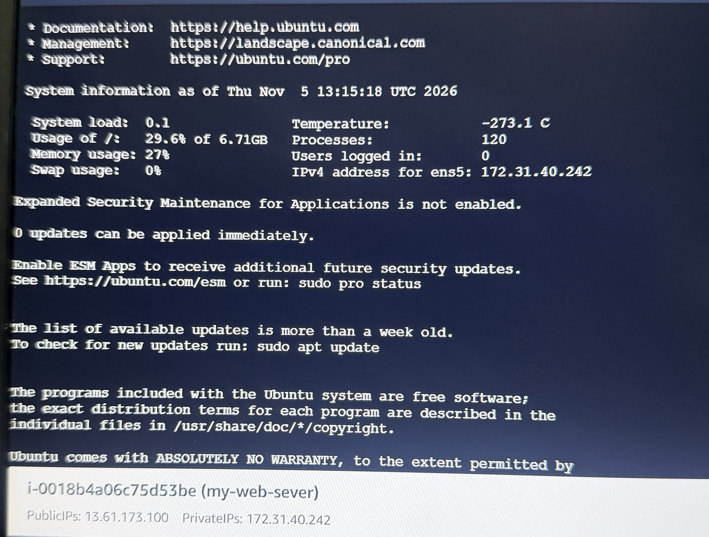
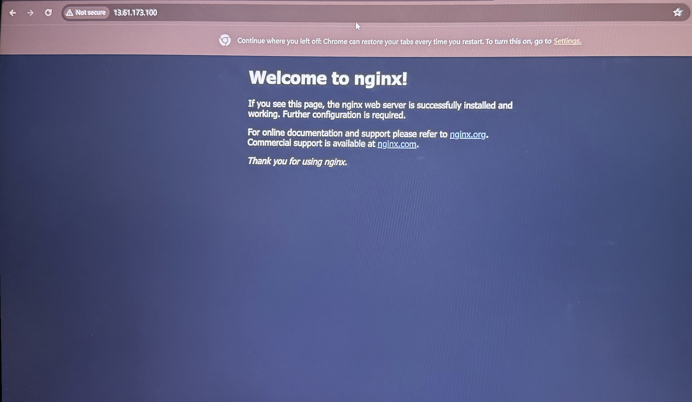
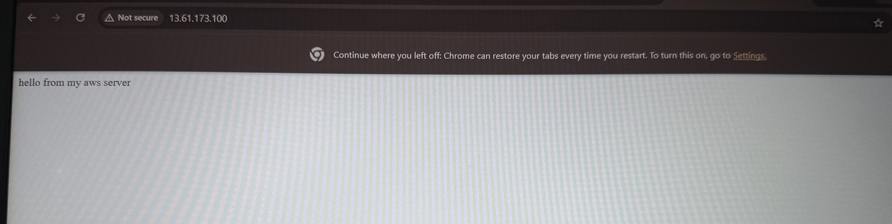
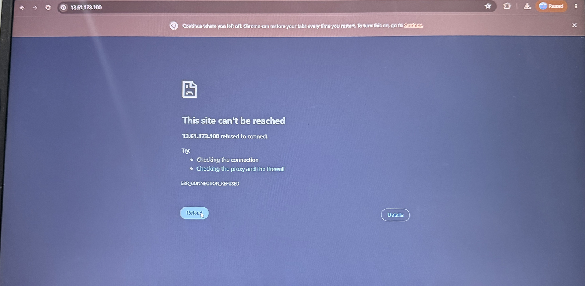
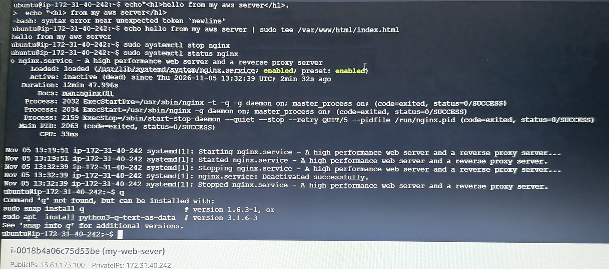
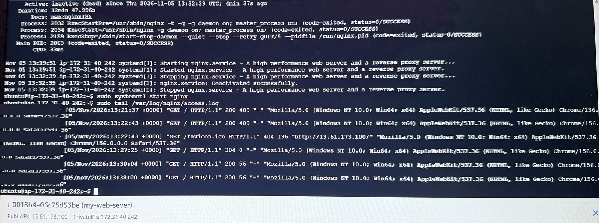
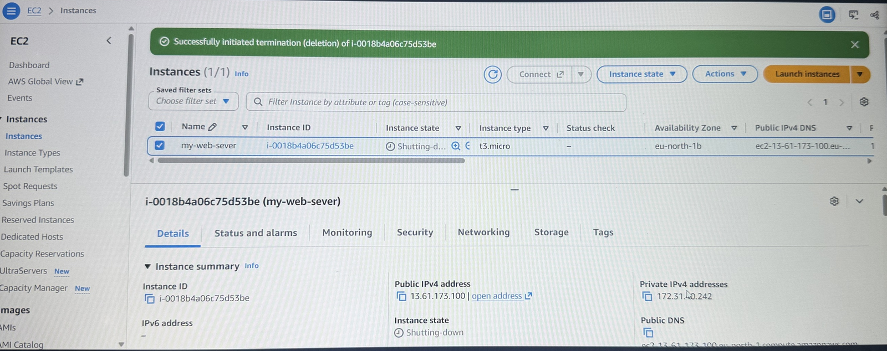

# AWS EC2 Web Server with nginx

Deployed a Linux web server on AWS and fixed a simulated outage.

## What I built
- Ubuntu 24.04 server on AWS EC2 (t3.micro)
- nginx web server serving my own web page
- Security group allowing SSH (22) and HTTP (80)

## Steps
1. Launched the EC2 instance and connected with EC2 Instance Connect
2. Installed and checked nginx:
   - sudo apt update
   - sudo apt install nginx -y
   - sudo systemctl status nginx
3. Replaced the default page with my own
4. Terminated the instance when done

## Troubleshooting
**Problem:** Site showed ERR_CONNECTION_REFUSED after I stopped nginx.
**Diagnosis:** systemctl status showed nginx "inactive (dead)". A refused connection means the server was reachable, but nothing was listening on port 80.
**Fix:** sudo systemctl start nginx. The site came back.

## Screenshots

